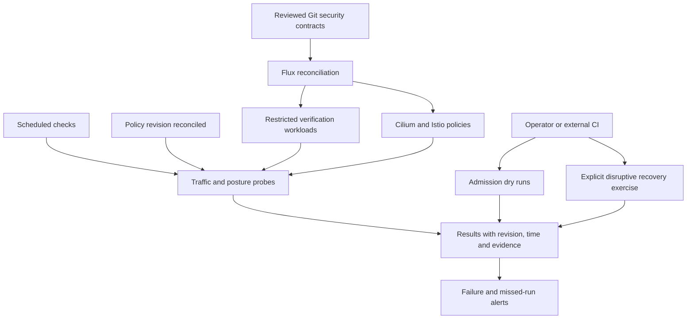

# Continuous security verification

Status: proposal for review. The initial network-security rollout completed on
2026-10-11. Flux converged at `be2a9606ae2616c6ffc6d7638a3a283cd6ad3092`.
Allowed and denied traffic and admission tests passed. No scheduled security
verification has been deployed. Disruptive mesh failure/recovery is still untested.

## Purpose and ownership

Verify actual enforcement continuously, alongside configuration and reconciliation
checks. A Ready Flux resource establishes convergence; a successful traffic probe
establishes that a particular security contract was enforced at the recorded time.
Neither establishes that every possible access path is safe.

Flux should own verification namespaces, service accounts, tightly scoped probe
policies, servers, scheduled jobs, and result collection. Ansible remains the
bootstrap/recovery entry point and can trigger the same contracts on demand.
The existing `scripts/homelab verify` is the initial working implementation.

## Security contracts

| Contract | Positive control | Required denial or condition |
| --- | --- | --- |
| Cross-node service access | Authorized identity reaches listening port 8080 | Same identity cannot reach listening port 8081 |
| Mesh identity | Authorized identity reaches the same server | Unauthorized identity with an L4 path is rejected |
| L4 grants | Server and mesh path proved healthy | Identity without the required L4 grant cannot reach the server |
| Direct internet | Designated external target is independently reachable | Application HTTP/TLS request fails without approved egress |
| Node services | Operator independently verifies node API availability | Application request to node API fails |
| Admission ownership | Test identity has narrowly scoped RBAC allowing the attempted operation | Admission rejects workload, service-account and policy self-grants |
| Pod restrictions | API-valid compliant pod passes a dry run | Privilege and ambient-capture bypass requests are rejected |
| Configuration | Expected protected resources are present | Default deny, strict mTLS, Restricted namespaces and explicit grants remain configured |
| GitOps | Expected source revision is available | All required reconciliations are Ready, current and resumed |
| Probe freshness | Schedule and result collector are healthy | Missing, incomplete or stale results cannot count as passing |

Use real HTTP/TLS requests for network checks. A TCP handshake through ztunnel
alone does not prove the destination accepted traffic. Each denial needs a working
positive control or independent evidence that the target is available. Missing
DNS, an unhealthy server or an unavailable external target produces an inconclusive
result and an alert, rather than a security pass.

Start with the existing three-node contracts; expand to each directed node pair
and IPv6 if IPv6 is enabled. Approved waypoint egress requires additional positive
and negative destination contracts when the first destination is configured.

## Execution model

Suggested initial cadence: every 15 minutes for nondisruptive checks, plus an
on-demand run after a reconciled security change. Frequency is a proposal, not a
configured schedule. Bound execution time, forbid overlapping runs, retain a
limited number of completed jobs, and clean up failed fixtures predictably.

Prefer Flux-created static servers and CronJobs with distinct service accounts
for traffic probes. Probe containers need no Kubernetes API token. Restrict each
allow rule to the verification namespace, identity and exact destination/port.
Verification grants must never widen application access or exempt probe pods
from Restricted Pod Security or ambient enrollment.

A separate posture collector may read the specific Flux, Cilium, Istio and
namespace resources required for configuration checks. It must not modify
security policy. Publishing a result requires only a dedicated output interface.

Keep privileged admission dry-run orchestration outside the cluster initially,
using the existing operator verification path or a deliberately configured CI
identity. The current test temporarily creates a namespace-scoped identity and
RBAC and proves admission rejects its otherwise RBAC-authorized requests. Do not
give a general scheduled probe cluster-admin or access to production controller
tokens to reproduce that test. A later in-cluster admission runner requires a
separate review of its exact authority and admission exceptions.

## Results and alerts

Each result records contract ID, tested identities and destinations, node pair,
expected and observed outcome, start/end time, reconciled Git revision, and
sanitized failure evidence. Exclude credentials and API tokens.

Report three states: pass, fail, and inconclusive. Record the last successful run
and last attempted run separately. Alert on unexpected access, missing authorized
access, stale reconciliation, and a missed or incomplete suite. A collector within
the cluster cannot reliably report a total cluster outage; an external freshness
watch must detect missing results.

The alert destination and external freshness watcher are open decisions. They
must be selected before claiming this is continuous assurance. Kubernetes Job
status and logs provide initial evidence but do not provide an independent alert
channel by themselves.

## Disruptive tests and rollout

Mesh outage, recovery, policy deletion protection and controller failure exercises
require an explicit operator trigger and a maintenance window. Do not schedule
these as routine production probes. Record their results separately from periodic
checks and keep their outstanding status visible.

1. Extract stable contract names and structured output from the working tests.
2. Deploy scheduled traffic fixtures and a read-only posture collector through
   Flux, with namespace-specific grants and bounded resource requests.
3. Add external result freshness monitoring and the chosen alert destination.
4. Demonstrate an intentional failing contract and a missed run both alert.
5. Connect policy changes to an on-demand suite; document how operators inspect
   and rerun failures.
6. Exercise disruptive mesh recovery separately before closing that deployment
   gate.

Acceptance requires demonstrated failures and stale-run detection as well as a
passing scheduled suite. A broken framework must be visible independently of its
own workloads.
