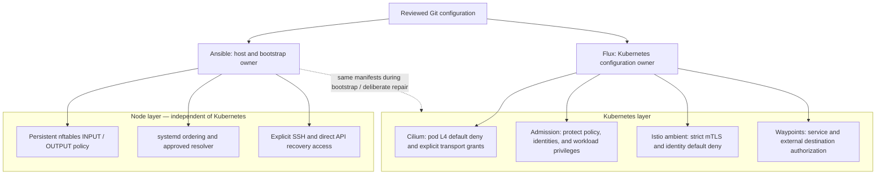
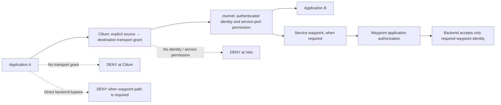
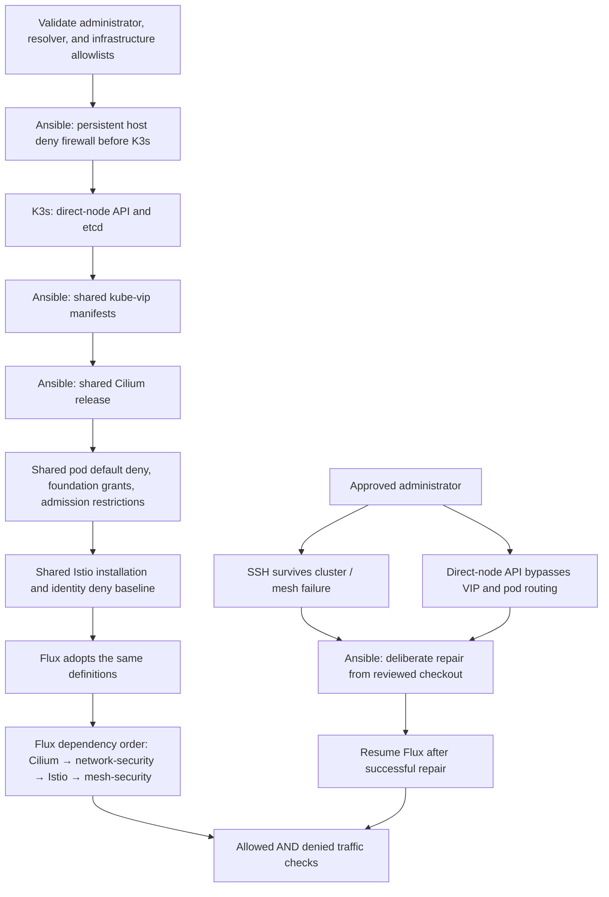

# Network security architecture

## Deployment status

These diagrams describe the security model agreed in [ADR 0006](../adr/0006-explicit-l4-network-access.md) and the configuration being prepared in this checkout. **It is not yet enforced on the live cluster.** The live inspection during this change found the Ansible/Flux foundation running Cilium and Flux, with Flux's stock broad network grants and no Istio installation or persistent host deny firewall. API-server dry runs validate definitions; they do not establish enforcement.

Do not treat this milestone as complete until the allow/deny and recovery checks pass after deployment. See [the verification matrix](#verification).

## Ownership

Git contains the authoritative configuration for both owners. Ansible handles the node layer because it must work before Kubernetes starts and when the cluster is unavailable. Flux owns the Kubernetes layer after bootstrap; Ansible uses the same definitions for initial installation and deliberate recovery.

| Configuration | Normal owner | Enforcement component | Shared source |
| --- | --- | --- | --- |
| Node ingress/egress and bootstrap exceptions | Ansible | nftables | `ansible/roles/host_firewall/`, `ansible/inventory/group_vars/all.yml` |
| Administrator and resolver inputs | Git; Ansible and Flux consume them | Host firewall and Cilium | `clusters/homelab/flux-system/network-inputs.yaml` |
| Cilium installation and pod transport grants | Flux | Cilium | `clusters/homelab/cilium/`, `clusters/homelab/security/network.yaml` |
| Policy/identity ownership and application restrictions | Flux | Kubernetes admission and RBAC | `clusters/homelab/security/admission.yaml` |
| Ambient installation and identity authorization | Flux | Istio CNI, ztunnel, and waypoint proxies | `clusters/homelab/istio/`, `clusters/homelab/mesh-security/` |

Cilium owns pod forwarding; the host firewall's INPUT/OUTPUT chains cover host processes and host-network workloads. Host-network applications are infrastructure exceptions because the host firewall cannot distinguish individual applications sharing the host network identity.

## Application traffic

Both layers require explicit permission. Cilium grants a transport path between selected endpoints, usually HBONE on TCP 15008 for mesh connections. Istio checks the authenticated caller and the actual service port inside the tunnel. Permitting the tunnel does not authorize every service connection it could carry.

A service without a waypoint still needs ztunnel authorization. A service whose security depends on a waypoint must restrict backend authorization to that waypoint's identity. New application namespaces require ambient enrollment and restricted Pod Security; applications cannot disable capture, relabel identities, or grant themselves access.

## Internet, LAN, and DNS

Application internet egress defaults deny at L4. The shared egress waypoint starts with no permitted external destinations. Adding an internet dependency requires an explicit workload-to-waypoint transport grant, an external service definition, per-workload authorization for that destination, and a waypoint-to-destination network grant. A waypoint alone is not an allowlist.

DNS-path restrictions do not prevent DNS exfiltration through arbitrary names queried via an approved resolver. Name filtering is a separate requirement. Protocols that cannot use the mesh remain denied for internet access unless a controlled proxy or specific infrastructure exception is approved.

Bootstrap infrastructure has separate, named destination exceptions: nodes need image/package downloads, and Flux's source-controller needs Git and the pinned chart repositories. Those exceptions do not grant application internet access. Host HTTPS destinations are resolved to IPv4 address sets; this enforces addresses and ports, not TLS hostnames on shared IP addresses.

## Bootstrap and recovery

Recovery restores the reviewed policies; it does not temporarily open all application traffic. Admission-policy or mesh failures should stop affected application connections. The host firewall remains loaded even if its systemd service stops; it does not depend on a Kubernetes controller for persistence.

## Verification

| Check | Expected result |
| --- | --- |
| Approved client on each other node → test service TCP 8080 | Allowed through ambient |
| Same client → same listening service on unauthorized TCP 8081 | Denied |
| Caller with a transport grant but an unauthorized service identity | Denied by mesh authorization |
| Caller without the transport grant | Denied at L4 |
| Application → public IP directly | Denied; operator checks the target is reachable first |
| Application → direct node API without permission | Denied |
| Privileged application, host port, capture opt-out, or unauthorized policy/identity change | Rejected by admission |
| Approved administrator → node SSH and direct API | Allowed |
| Unapproved source / destination → host listening port or host egress target | Denied by host firewall |
| Mesh unavailable | Application access fails closed; administrative recovery remains usable |

`security` is the deliberate migration command; `verify` performs the cross-node traffic checks. Repository checks render manifests and Helm charts and validate security contracts. The complete live matrix, including disruption/recovery, remains a deployment gate; a passing static check is not a substitute.
