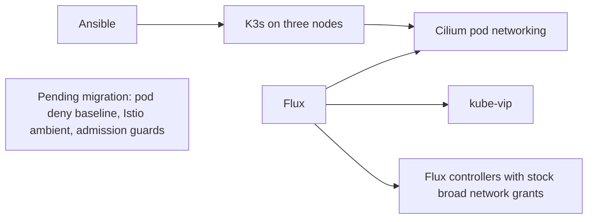
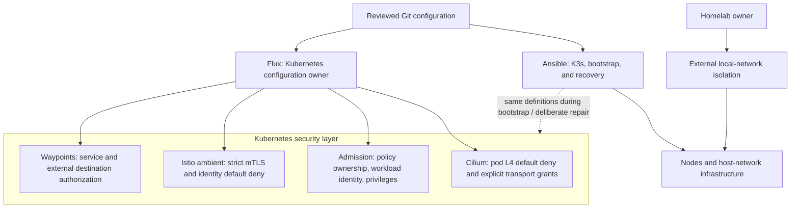
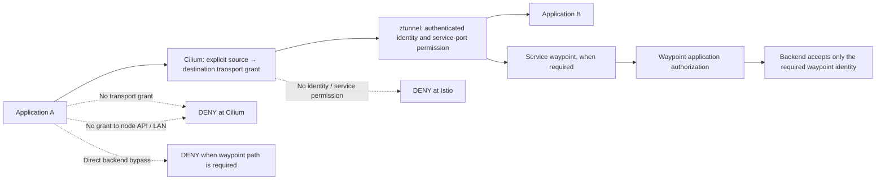
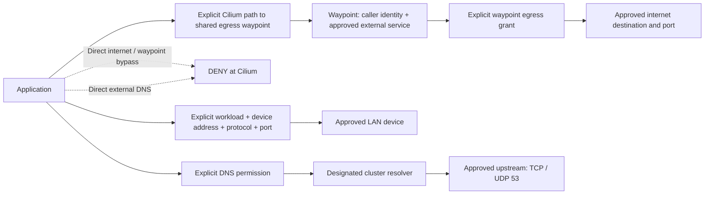
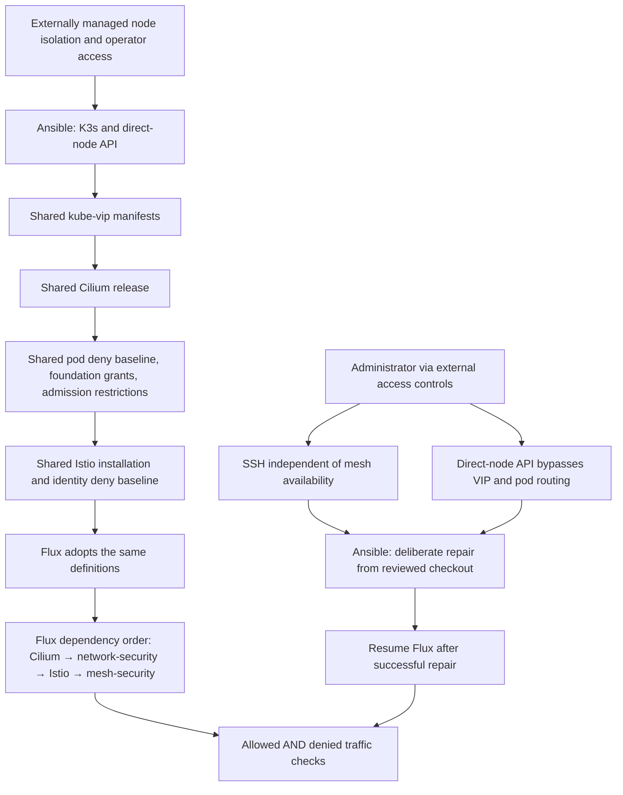

# Network security architecture

## Deployment status

These diagrams describe the model agreed in [ADR 0006](../adr/0006-explicit-l4-network-access.md) and the configuration in this PR. **The live cluster has not been migrated.** Inspection found Cilium and Flux running, Flux's stock broad network grants, and no Istio installation. Dry runs and manifest checks validate configuration; they do not prove live enforcement.

Node and host-network isolation is managed by the homelab owner through external local-network controls. This repository does not configure node firewalls or administrator CIDR allowlists. Cilium still restricts pod access to node services.

## Current observed deployment

## Ownership after migration

Git is authoritative for the Kubernetes security model. Flux owns ongoing reconciliation; Ansible consumes the same definitions for bootstrap and deliberate recovery. The external node-isolation boundary is separate from those owners.

| Configuration | Normal owner | Enforcement component | Shared source |
| --- | --- | --- | --- |
| Node and host-network isolation | Homelab owner, outside this repo | External network controls | Outside this repo |
| K3s installation and recovery access | Ansible | Host services and direct-node API | `ansible/`, `os/` |
| Cilium installation and pod transport grants | Flux | Cilium | `clusters/homelab/cilium/`, `clusters/homelab/security/network.yaml` |
| Approved upstream DNS destination for CoreDNS | Flux | Cilium pod egress policy | `clusters/homelab/flux-system/network-inputs.yaml` |
| Policy/identity ownership and application restrictions | Flux | Kubernetes admission and RBAC | `clusters/homelab/security/admission.yaml` |
| Ambient installation and identity authorization | Flux | Istio CNI, ztunnel, and waypoints | `clusters/homelab/istio/`, `clusters/homelab/mesh-security/` |

Host-network workloads share node networking and are outside the pod deny baseline. Ordinary applications cannot use host networking or equivalent privileges; trusted infrastructure is an explicit exception. There is no repository-managed node INPUT/OUTPUT firewall.

## Application traffic

Both layers require permission. Cilium permits a path between selected endpoints, usually HBONE on TCP 15008. Istio checks the authenticated caller and actual service port inside that tunnel. A tunnel grant does not authorize every service connection it can carry.

A service without a waypoint still needs ztunnel authorization. A service whose security depends on a waypoint must authorize that waypoint's identity at the backend. Application namespaces require ambient enrollment and restricted Pod Security. Application identities cannot disable capture, change workload identities, or grant network access.

## Internet, LAN, and DNS

Application internet egress defaults deny at L4. The shared egress waypoint starts with no permitted external destinations. Adding an internet dependency requires a workload-to-waypoint path, an external service definition, per-workload destination authorization, and a waypoint-to-destination network grant.

Resolver-path restrictions do not prevent DNS exfiltration through arbitrary names queried via the approved resolver. Name filtering is separate. Internet protocols unsupported by the mesh remain denied unless a controlled proxy or specific infrastructure exception is approved.

Flux's source-controller has a named non-mesh bootstrap exception for Git and the pinned chart repositories. It does not grant application internet access. Node image/package downloads and host-network egress are outside these pod policies and depend on the externally managed node isolation.

## Bootstrap and recovery

Recovery restores the reviewed policies rather than opening application traffic. API and SSH access must remain usable through the externally managed node controls. Mesh enrollment, identity, or authorization failures should stop affected application connections.

## Verification

| Check | Expected result |
| --- | --- |
| Approved client on each other node → test service TCP 8080 | Allowed through ambient |
| Same client → same listening service on unauthorized TCP 8081 | Denied |
| Caller with a transport grant but unauthorized service identity | Denied by mesh authorization |
| Caller without a transport grant | Denied at L4 |
| Application → public IP directly | Denied; operator first checks the target is reachable |
| Application → direct node API without permission | Denied by pod policy |
| Privileged application, capture opt-out, or unauthorized policy/identity change | Rejected by admission |
| Mesh unavailable | Application access fails closed; external administrative recovery remains usable |

`security` performs the deliberate cluster-policy migration; `verify` runs the cross-node and admission checks. Repository checks render manifests and exact Helm values and validate security contracts. The full live matrix, including a disruptive mesh outage/recovery exercise, remains a deployment gate. Node firewall tests and administrator CIDRs are outside this model.
