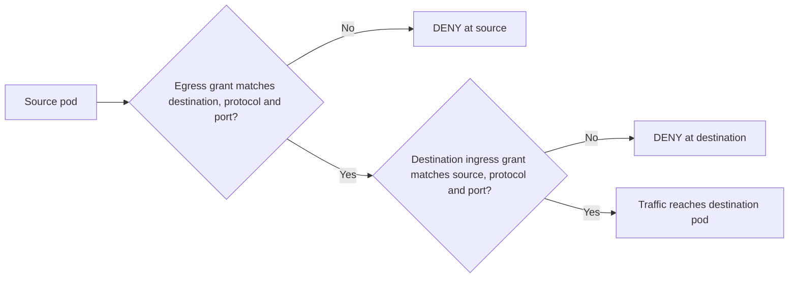
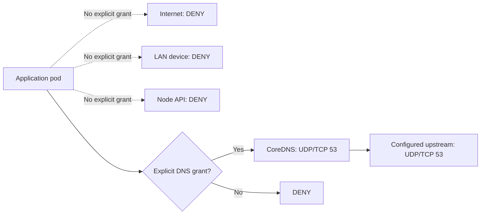
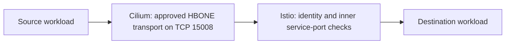
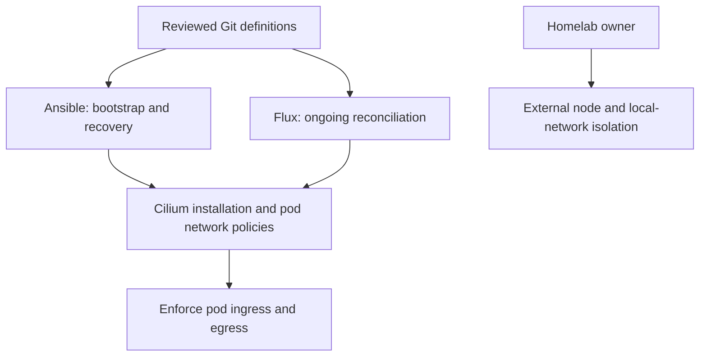
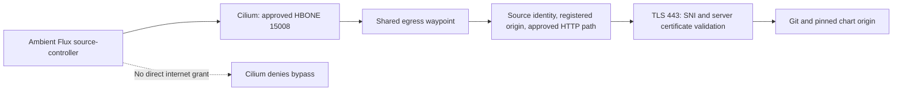

# L4 network protection

This first architecture lesson covers how Cilium controls pod traffic using source,
destination, protocol, and port. The agreed security model is recorded in
[ADR 0006](../adr/0006-explicit-l4-network-access.md). Istio is also deployed; its registered TLS egress boundary is described below.
Admission controls are deferred to [issue #26](https://github.com/liamawhite/homelab/issues/26).

## Default deny

Every ordinary Cilium-managed pod starts with ingress and egress denied. A grant
opens only its selected direction, peers, protocol and ports. Policies are
additive: any matching allow policy can grant access, so an additional broad allow
would weaken this baseline.

The baseline is `homelab-default-deny` in
[`network.yaml`](../../clusters/homelab/security/network.yaml). Its empty endpoint
selector selects all managed pod endpoints; both `enableDefaultDeny.ingress` and
`enableDefaultDeny.egress` are true. Its nonempty ingress/egress rules select Cilium’s `none` entity, which matches no real peer. Empty lists were rejected by the deployed Cilium version; the corrected form was validated live.
The baseline is protected from accidental Flux pruning.

For pod-to-pod traffic, both sides need permission. Allowing a pod to send traffic
does not automatically allow the receiving pod to accept it. Reply traffic for an
allowed connection is tracked by Cilium; it does not need a separate grant for a
new reverse connection.

Grants select workloads by namespace, service account and other explicit labels,
or select a specific infrastructure entity/address. A grant should identify who
needs access, where they connect, the protocol/port, and why that connection is
required.

## Existing explicit grants

The current grants support cluster infrastructure. They do not provide general
application-to-application, LAN, or internet access.

| Path | Allowed transport | Purpose |
| --- | --- | --- |
| Named foundation service accounts → Kubernetes API | TCP 443 / 6443 | Cluster controllers and networking |
| Named DNS clients or explicitly DNS-enabled workloads → CoreDNS | UDP and TCP 53 | Cluster name resolution |
| CoreDNS → configured upstream `192.168.1.1/32` | UDP and TCP 53 | Upstream resolution |
| Metrics-server → kubelets | TCP 10250 | Node metrics |
| Flux helm/kustomize controllers → source-controller | TCP 9090 | Fetch reconciled artifacts |
| Flux source/helm/kustomize controllers → notification-controller | TCP 9090 | Controller events |
| Source-controller → approved Git/chart hosts | TCP 443 | GitOps bootstrap and reconciliation |
| Ambient infrastructure → Istiod | TCP 15012 | Mesh configuration |
| Node-origin health probes → named foundation workloads | Specific probe ports only | Check workload health |
| Cilium health endpoints ↔ node entities | TCP 4240 and explicit ICMP echo | Cilium health checks |

The source-controller exception names `github.com`, `helm.cilium.io`, and
`istio-release.storage.googleapis.com`. Its Cilium FQDN rule uses observed DNS
answers to select destination IPs. The DNS proxy rule used to learn those answers
is a supporting DNS-layer mechanism; a TCP 443 grant does not authorize particular
HTTP paths or application actions.

DNS permission allows queries through the approved resolver. It does not filter
all queried names or prevent DNS exfiltration through those names.

## Internet, LAN and nodes

A future LAN dependency needs an explicit workload-to-device address and
protocol/port grant. An internet dependency follows the agreed egress-waypoint
model and needs separately reviewed transport grants. No application internet
destinations are currently approved.

These policies protect pod traffic. Host-network workloads share node networking
and are outside this baseline. Node firewalls and local-network isolation are
managed externally by the homelab owner. Cilium's `allow-localhost: policy` setting
removes the implicit local-node ingress allowance for managed pods; required
node-origin probes have explicit grants.

## The L4 boundary with ambient networking

With Istio ambient enabled, pod-to-pod traffic can travel through HBONE on TCP
15008. Cilium controls that transport path. The destination service port inside
the tunnel is checked by Istio. Allowing HBONE therefore permits a transport
path; service identity and inner-port authorization are a separate layer.

## Ownership

Git contains the reviewed definitions. Ansible installs the shared configuration
for bootstrap and deliberate recovery; Flux owns ongoing reconciliation.

| Concern | Owner | Source |
| --- | --- | --- |
| K3s installation and direct-node recovery access | Ansible | `ansible/`, `os/` |
| Cilium installation and localhost policy setting | Flux after bootstrap | `clusters/homelab/cilium/` |
| Pod default deny and explicit grants | Flux after bootstrap | `clusters/homelab/security/network.yaml` |
| Approved CoreDNS upstream address | Flux | `clusters/homelab/flux-system/network-inputs.yaml` |
| Node and host-network isolation | Homelab owner | External controls |

The initial rollout completed on 2026-10-11. Flux converged at
`be2a9606ae2616c6ffc6d7638a3a283cd6ad3092`. Verification implementation and continuous
checks are tracked separately in [issue #25](https://github.com/liamawhite/homelab/issues/25).

Admission ownership and Pod Security enforcement are deferred. Existing Kubernetes
RBAC still applies, but L4 rules alone do not prevent a sufficiently authorized
API identity from changing policy or deploying a host-network/privileged workload.
The removal PR requires the documented migration before previously deployed
admission controls are retired.

## Registered TLS egress gateway

[ADR 0008](../adr/0008-require-gateway-for-pod-internet-egress.md) requires all ordinary-pod internet connections, including Flux and Tailscale, to traverse the shared egress waypoint. Only explicitly registered destinations are allowed, and the gateway originates external TLS with certificate validation. External TCP 80 and client TLS passthrough are denied. Service registration and `REGISTRY_ONLY` are not an ambient security boundary by themselves; Cilium and gateway authorization enforce the paths.

Flux Git and chart URLs use HTTP carried through mesh mTLS. A pinned internal Istio index preserves upstream digests while replacing absolute HTTPS chart URLs with HTTP origins for gateway TLS origination. Bootstrap establishes this path before source-controller starts. The source-controller’s old direct-download exception is removed; only the gateway has FQDN-scoped external TCP 443 grants.

Ambient local delivery and probes use `169.254.7.127`; Cilium grants that exact source only on required receiver ports. Ztunnel authorization still controls authenticated application requests. Istio Envoy access logs emit JSON on `/dev/stdout`, while ztunnel retains its own connection logs.

Live verification covered a fresh Flux Git clone (including upload-pack POST), all pinned Cilium/Istio charts, exact upstream SNI/certificate validation, denied identities/paths/unregistered destinations/direct 80/443 bypass, and gateway outage/recovery. All active foundation controllers and Helm releases are healthy. Root and four foundation Kustomizations are held pending review/merge of the staged definitions; Tailscale remains blocked pending mandatory TLS-origination compatibility. See the [migration notes](../tailscale-migration.md).

Global admission enforcement remains deferred to issue #26. The explicitly requested restricted Tailscale namespace and proxy security contexts remain scoped to that migration; this change does not reinstate the older global admission policies. Node and host-network isolation remain externally managed.
